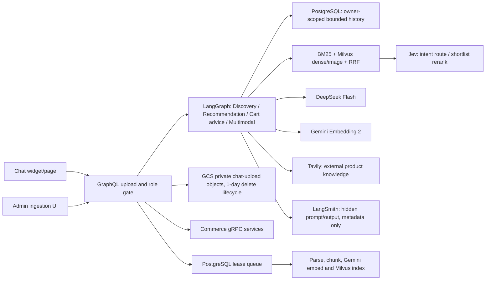

# Chatbot mua sắm GoshopX: trạng thái, cấu hình và vận hành

## Kiến trúc hiện có



The four agent names are distinct LangGraph routes in the recommender process. They share one grounded executor and bounded tool loop. Discovery searches store products; Recommendation compares fields available in catalog data; Cart only gives advice; Multimodal extracts visible product attributes and retrieves similar catalog items. Only catalog product images are rendered as product cards.

### Tavily's allowed role

Tavily can fill a narrow knowledge gap for general product terminology or externally documented features when the store catalog does not contain that information. Recommendation may call it at most once per turn. The integration asks for at most three basic-search results, caches results for five minutes, and omits raw page content/images. Results are labeled as external sources. They cannot establish GoshopX price, stock, discount, coupon, delivery promise, warranty coverage, or a component compatibility claim. If no useful source is returned, the answer must say the catalog lacks the fact.

### Jev and retrieval

Jev receives a redacted bounded conversation/request string for routing. Active routing is accepted only for a known route with probability at least `0.85` and margin at least `0.20`; invalid, low-confidence or failed calls fall back to deterministic routing. Rerank receives at most ten candidates and returns the original RRF order when scores are invalid or the call fails. In the current configuration `JEV_RERANK_ENABLED` defaults to false. `JEV_MODE` defaults to `shadow`; `NODE_ENV=production` forces Jev routing off. Explicitly opt in for a measured lab smoke only after checking the AI spend ledger.

Lexical search uses application BM25 as a local fallback and Milvus native BM25 sparse + dense hybrid search in each newly built product generation, with RRF fusion; image retrieval is a separate candidate list. Admin-managed source chunks are supported. Product vector generations use distinct text/image collections and a PostgreSQL manifest; build failures leave the serving generation active, and activation/rollback changes the serving pointer transactionally. Product events dual-write to the active and in-progress generations. Retired collections are retained for rollback and are not automatically deleted. The legacy collection does not have the native BM25 function and remains on dense + local BM25 until the first generation is activated.

## Session, privacy and images

The browser sends a session ID, but the ID is not authorization. GraphQL derives an authenticated owner or issues/verifies a signed HttpOnly guest cookie. Recommender HMAC-scopes thread IDs, serializes concurrent writes for one thread, retains a bounded recent history, expires inactive conversations after seven days, and exposes a delete-session mutation. The UI only clears local history after server deletion succeeds. This is a bounded PostgreSQL message store; it is not a LangGraph Postgres checkpointer with summary compaction.

With GCS enabled, GraphQL validates image size and MIME signature, normalizes before private storage under `chat-upload/`, and forwards only a `gs://` reference. JPEG and PNG are fully decoded, capped at 20 megapixels, and re-encoded to remove metadata; JPEG EXIF orientation is applied before re-encoding. WebP container/frame dimensions are bounded, EXIF/XMP/ICC chunks and feature flags are stripped, and non-default EXIF orientation is rejected to avoid returning a wrongly oriented image. The repository does not include a WebP pixel decoder, so malformed compressed WebP data can pass container parsing and fail at a provider; treat WebP validation as weaker than JPEG/PNG until a decoder is added. Recommender Workload Identity can read only its configured bucket/prefix through the metadata server token flow. The bucket lifecycle deletes temporary uploads after one day. DeepSeek and Gemini receive normalized image bytes for the requested vision/embedding operation.

## Configuration

Put provider values only in ignored `F:\GoshopX\.env` for local work or Secret Manager for GKE. Do not paste values into chat, commit them, print them, or place them in Terraform plan output.

```dotenv
DEEPSEEK_API_KEY=
DEEPSEEK_BASE_URL=https://api.deepseek.com/chat/completions
DEEPSEEK_MODEL=deepseek-flash
GEMINI_API_KEY=
GEMINI_EMBEDDING_MODEL=gemini-embedding-2
GEMINI_EMBEDDING_DIMENSION=768
TAVILY_API_KEY=
TYPESAFE_API_KEY=
TYPESAFE_JEV_ENDPOINT=https://api.typesafe.ai/v1/systemone
TYPESAFE_JEV_MODEL=jev-1.14.0
JEV_MODE=shadow
JEV_RERANK_ENABLED=false
LANGSMITH_API_KEY=
LANGSMITH_ENDPOINT=https://api.smith.langchain.com
LANGSMITH_PROJECT=goshopx-recommender
AI_SPEND_LIMIT_VND=200000
AI_SPEND_RESERVE_PER_CALL_VND=500
AI_DEEPSEEK_PROMPT_VND_PER_MILLION_TOKENS=
AI_DEEPSEEK_COMPLETION_VND_PER_MILLION_TOKENS=
AI_GEMINI_PROMPT_VND_PER_MILLION_TOKENS=
AI_GEMINI_COMPLETION_VND_PER_MILLION_TOKENS=
AI_TAVILY_CALL_VND=
AI_TYPESAFE_CALL_VND=
```

Legacy `AI_API_KEY`, `AI_ENDPOINT`, and `AI_MODEL` are DeepSeek-only aliases. An unrelated provider key is never substituted. Hash embeddings are an offline/test-only 512-dimensional fallback; do not use them with the Gemini 768-dimensional Milvus collection. If no generation has been activated, the recommender reads the legacy collection selected by `MILVUS_COLLECTION`. After initial catalog sync and after checking the Gemini spend ledger, run `python main.py rebuild-catalog-index` to build and atomically activate a versioned collection. Run `python main.py rollback-catalog-index <retired-generation-id>` to switch to a retained generation. A build resumes its candidate collection after transient failures; do not delete collections while a registry row is `building`. Retired collections are not automatically deleted.

Gemini Embedding 2 requests use the multimodal `batchEmbedContents` schema without the legacy `taskType` field; short document/query instructions are included in text content. Catalog thumbnail requests are grouped up to 8 MiB of raw image data and 100 images per request. Explicit catalog bootstrap indexes one product page at a time and updates `indexed_hash` only after the full text/image vector write succeeds.

Chat memory is persisted in PostgreSQL under a server-derived HMAC thread key. It keeps a compact summary of older user requests and referenced product IDs plus recent turns; that bounded context feeds retrieval, route selection and the answer prompt. This is durable application memory, not LangGraph's native checkpoint saver, so an interrupted graph execution is not resumed mid-node.

## Spend controls and tracing

Before each outbound provider request, the PostgreSQL ledger reserves `AI_SPEND_RESERVE_PER_CALL_VND` under an advisory lock and refuses when current settled cost plus unresolved reservations would exceed `AI_SPEND_LIMIT_VND`. DeepSeek and Gemini responses settle against provider-reported token counts when both corresponding `*_VND_PER_MILLION_TOKENS` rates are configured. Tavily and TypeSafe use operator-configured per-call VND rates. Rates are intentionally blank by default; an unpriced response retains its reservation instead of being recorded as free. Timeouts and server errors also retain the reservation because the provider may have processed the request; confirmed client rejections release it. This is an application estimate, not provider invoice reconciliation, and a just-completed request can exceed its reservation before the next request is blocked. Keep rates aligned with current provider billing and check provider billing and the ledger before/after each live smoke. Do not run provider-backed k6 load tests.

Inspect usage in the recommender PostgreSQL database (Cloud SQL Studio, database `recommender`):

```sql
SELECT provider, status, COUNT(*) AS calls,
       SUM(input_tokens) AS input_tokens, SUM(output_tokens) AS output_tokens,
       SUM(reserved_vnd) AS reserved_vnd,
       SUM(COALESCE(actual_vnd, reserved_vnd)) AS counted_vnd
FROM ai_spend_entries
WHERE created_at >= CURRENT_TIMESTAMP - INTERVAL '7 days'
GROUP BY provider, status
ORDER BY provider, status;
```

Before a provider smoke, compare current provider pricing with your billing currency and configure integer VND-per-million-token rates for DeepSeek/Gemini and per-call VND rates for Tavily/TypeSafe. Leave a rate blank when it has not been verified; the call then remains counted at its reservation amount. The configured ceiling is a request gate, not a guarantee that one in-flight provider request cannot exceed it.

The custom LangSmith callback sends route, bounded character count, product count, safe warning codes, latency and a redacted marker; it sets `hide_inputs` and `hide_outputs`. It does not send prompts, completions, session/account identifiers, cookies, image bytes or tool payloads. Automatic LangChain tracing is kept off (`LANGCHAIN_TRACING_V2=false`). If LangSmith callback behavior changes, re-run its redaction test before enabling it.

## Admin knowledge preview and audit

From **Admin → Dữ liệu AI**, choose an existing product link if needed and select PDF, DOCX, TXT, Markdown, JSON or CSV. The first request parses the file locally in the recommender service and returns up to three chunk samples, chunk/character counts and a token-based embedding estimate. This preview does not upload to GCS or call an AI provider. The VND estimate is shown only when `AI_GEMINI_PROMPT_VND_PER_MILLION_TOKENS` is set; it is approximate because provider tokenization can differ from the character/4 estimator. Click **Đưa vào hàng đợi xử lý** to upload the original to private GCS and enqueue a leased job. Only published sources are searchable by the customer assistant.

Enqueue, cancel, retry, publish and revoke actions create actor-attributed rows in `ai_ingestion_audit_events` in the same PostgreSQL transaction as the state change. The admin AI-data panel reads the latest 50 records. Job execution attempts are represented by job status/attempt count rather than separate audit records.

## Low-volume real-provider smoke in the deployed lab

This is an operator procedure, not evidence that providers or GKE are currently healthy. First confirm current credit, the lab stop deadline and the configured AI ceiling. Provider calls can incur charges.

1. Add/rotate `DEEPSEEK_API_KEY`, `GEMINI_API_KEY`, `TAVILY_API_KEY`, `TYPESAFE_API_KEY`, and `LANGSMITH_API_KEY` in Secret Manager using the existing local script. To add missing provider keys only, run `powershell -ExecutionPolicy Bypass -File .\infra\gcp\add-runtime-secret-versions.ps1`; to rotate provider keys from `.env`, add `-RefreshProviderKeys` (this intentionally creates new versions for provider keys only). Never display secret payloads. Confirm each latest secret version is `enabled` using `gcloud secrets versions list`.
2. Configure provider prices only after verifying them against provider billing; otherwise leave the rates blank so calls retain the conservative reservation. Set non-secret flags in `deploy/helm/goshopx/values-gcp-lab.yaml` for a lab-only run: `JEV_MODE: shadow`, `JEV_RERANK_ENABLED: "true"`, and `AI_SPEND_LIMIT_VND: "200000"`. Keep active route selection in shadow while proving the provider path; the deterministic route remains authoritative. Review `terraform output project_id`, cluster and namespace before deployment.
3. Commit/push the change. Wait for `CI quality gates` and `GCP lab image build, scan and GitOps promotion` to pass, merge the generated GitOps promotion PR, and wait until Argo CD reports `Synced` and `Healthy`. Never apply a stale digest manually.
4. Confirm pods are ready and private GCS upload access works from the recommender service account. Confirm SecretSync has synchronized the latest versions. Check `kubectl logs` without printing secret environment values. `recommender-sync` no longer performs a full catalog bootstrap on restart; after checking Gemini quota and the spend ledger, run `kubectl exec deployment/recommender-sync -n goshopx -- python main.py bootstrap-catalog` only when the catalog vector backfill is needed. The `indexed_hash` checkpoint makes retries safe. Stop if Gemini returns repeated 429s.
5. In the UI on `https://goshopx.click`, run one text product query (DeepSeek; Jev shadow routing), one comparison requiring external public knowledge (Tavily may call at most once; source links should display), and one small JPEG/PNG/WebP image query (GCS upload, DeepSeek vision and Gemini image embedding). Verify results are catalog items and store facts remain backend-sourced. Run only a single turn per check.
6. Check the redacted LangSmith project for metadata-only runs; do not use an unredacted debug trace. Inspect cost/reservation ledger and provider billing after the smoke. Stop if any error or spend ceiling is reached.
7. Revert lab-only flags through GitOps after the test. Do not run load/stress tests with live AI providers.

For local offline unit checks:

```powershell
Set-Location F:\GoshopX\recommender
$env:UV_CACHE_DIR = 'F:\GoshopX\.uv-cache-chatbot'
$env:UV_PROJECT_ENVIRONMENT = 'F:\GoshopX\recommender\.venv-trivy-fix'
$env:PYTHONPATH = 'app'
uv run --locked python -m unittest discover -s tests -v
```

The tests stub providers and do not prove credentials, network access, provider model availability, billing, GCS IAM or GKE deployment.

The current local Windows environment can run the offline suite without recreating its locked virtual environment:

```powershell
$env:PYTHONPATH = 'F:\GoshopX\recommender\app;F:\GoshopX\recommender'
$env:DATABASE_URL = 'sqlite:///:memory:'
& 'F:\GoshopX\recommender\.venv-security\Scripts\python.exe' -m unittest discover -s F:\GoshopX\recommender\tests -q
```

## Commerce boundary and remaining work

The chat UI can create a server-side cart proposal from in-stock catalog results. Cart owns the proposal, validates the account, expected cart version, idempotency key and ten-minute expiry, then reserves inventory and persists the merged cart only after explicit confirmation. The UI stores only the proposal request, owner account ID and idempotency key locally; after refresh it checks the signed-in account and resubmits the same idempotent request to recover the server proposal. A different account clears the local pending request. A partial reservation failure compensates earlier reservations. After confirmation the UI asks Order for a non-consuming quote in integer VND and displays subtotal, discount, total and expiry; preview does not reserve coupon uses or inventory. It carries an optional coupon code to Checkout, which requests a fresh quote. COD and VNPAY checkout send quote ID and version back to Order, which locks and validates the quote, re-fetches current catalog prices, rechecks coupon eligibility and records quote consumption, order and coupon redemption atomically. Repeating the same quote returns its existing order. Payment reloads that order and verifies owner, pending status, exact items, current catalog subtotal, discount and payable amount before creating a VNPAY transaction. VNPAY retries reuse the pending transaction if URL creation fails after order persistence. Coupon lifecycle administration is not provided in this lab; coupon rules and usage are enforced by Order, and `infra/gcp/seed-lab-coupon.sql` seeds `LAB10`.

The admin path supports private upload, parser preview, idempotent enqueue, job status/cancel/retry, publish/revoke, an actor-attributed ingestion audit log and retrieval of published content only. Admins may optionally link a document to an existing product. Linked content is considered only when that product is in the current catalog shortlist; an unlinked document remains global. The link is stored on the source and copied into chunk/vector metadata. VNPAY retries reuse the pending order transaction if checkout URL creation fails after persistence. DummyJSON import tags each product with source system, source ID and a per-run snapshot UUID; the importer rejects inconsistent totals, offsets, duplicate IDs and partial snapshots. Inventory seed validates the full response and initializes each stock row only once, preserving later stock changes on reruns. Vector generation rebuild captures the eligible ID/hash manifest and refuses activation if the source catalog changed during indexing. Image upload fully decodes JPEG/PNG/WebP pixels, enforces the pixel limit, normalizes orientation where supported, and re-encodes to strip metadata; animated or rotated WebP is rejected. Remaining source/operations work: provider invoice reconciliation/dashboard, native LangGraph checkpoint saver, production-grade guest/account isolation verification, and live GKE/provider/browser acceptance. Track these in [the implementation TODO](../tasks/todo.md).

### Ingestion worker foundation status

The source tree includes a PostgreSQL lease queue, idempotency key, bounded retries, GCS private-object reader restricted to `knowledge-upload/` with SHA-256 verification, and parsers/chunking for PDF, TXT, Markdown, JSON, CSV, and DOCX. GraphQL limits upload/manage actions to operations/platform admins; worker writes source-version chunks and deterministic IDs to a separate Gemini collection. Publishing requires a completed job with chunks; retrieval filters current-version published sources in PostgreSQL after Milvus dense lookup and lexical matching. Text PDFs are supported up to 200 pages; scan-only PDFs require OCR. The source path is implemented, but live GCS/Milvus/GKE acceptance has not been performed.
