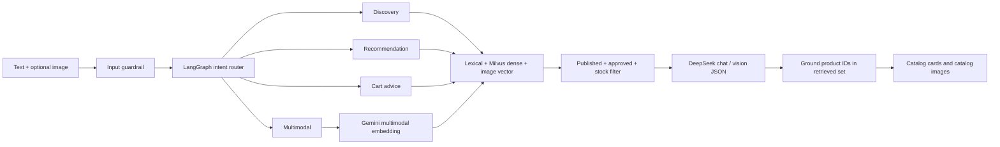

# Shopping assistant: current implementation and next gates

## Runtime flow



The four named paths are LangGraph nodes inside the existing recommender service. Each has a role-specific prompt and shares the catalog-grounded executor. The visual path embeds uploaded image bytes with Gemini and searches the Gemini image collection, then fuses candidates with text/lexical retrieval. User-uploaded image bytes are limited and validated at GraphQL/Python boundaries; browser history strips image data before persistence. Only catalog product images are returned to the UI.

## Configuration

For local development, set these names in the ignored `recommender/.env` or process environment. Never paste values in docs, shell history or CI logs.

```dotenv
DEEPSEEK_API_KEY=
DEEPSEEK_BASE_URL=https://api.deepseek.com/chat/completions
DEEPSEEK_MODEL=deepseek-flash
GEMINI_API_KEY=
GEMINI_EMBEDDING_MODEL=gemini-embedding-2
GEMINI_EMBEDDING_DIMENSION=768
MILVUS_COLLECTION=product_catalog_gemini_v2
AI_TIMEOUT_SECONDS=30
AI_MAX_RETRIES=1
```

Legacy `AI_API_KEY`, `AI_ENDPOINT`, and `AI_MODEL` are still read as fallbacks. If Gemini is unset, the local/test path uses deterministic 512-dimensional hash embeddings; do not point that mode or its collection at the Gemini 768-dimensional collection. The GCP overlay selects a new Gemini collection. Reindex all products before enabling that deployment; do not assume an existing index has migrated.

## Commerce authority and actual limits

The Cart node can recommend in-stock items and explain how to review them; it cannot currently create a server-side action proposal, apply coupons, mutate a cart, or prepare an order. Clicking the normal Add to cart UI remains a user-confirmed backend operation. The backend must recheck price, stock and coupon eligibility. No payment or checkout is ever executed from a prompt.

This slice does not yet implement server-persisted chat sessions/checkpointing, seven-day retention, delete-history API, per-request provider token/spend ledger, Tavily retrieval, Jev System One routing/reranking, or redacted LangSmith tracing. Those are required follow-up gates before describing the assistant as a complete agentic commerce feature. `TAVILY_API_KEY`, `TYPESAFE_API_KEY`, and `LANGSMITH_API_KEY` may exist in local `.env`, but the runtime does not consume them yet. Avoid enabling automatic third-party tracing until user text, retrieved content and uploaded image bytes are redacted and reviewed.

## Verify

```powershell
Set-Location F:\GoshopX\recommender
.venv-security\Scripts\python.exe -m unittest discover -s tests -v
```

The suite checks routing safety, product grounding, RRF, query parsing, vector schema and image validation. Live provider behavior, Gemini availability/quota, DeepSeek vision, Milvus schema creation and retrieval quality require separate low-volume integration tests. Do not include live providers in k6 traffic; see [load testing](./load-testing.md).
