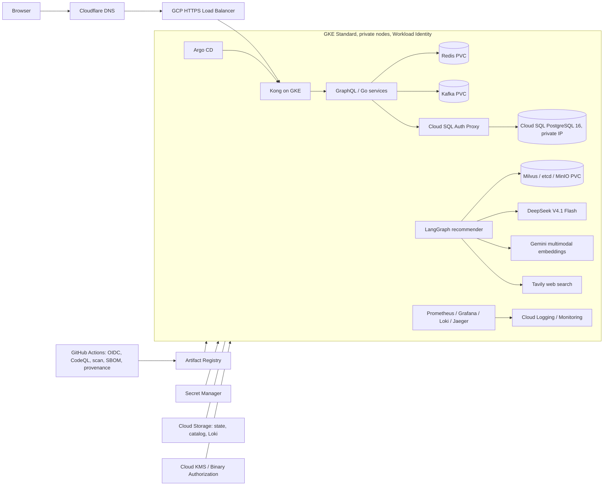

# GoshopX GCP 48-hour lab

This is an **unapplied lab configuration** targeting the existing project `generated-mote-467410-b0`. Terraform will not create, rename, relabel, or delete the project. It will create named GoshopX resources inside it and manage selected project APIs/IAM bindings. Review the plan carefully because this project may contain unrelated resources. Do not run `apply` until live credit expiry, billing currency, SKU estimate, target-project quota, available resource names, and the lab window have been checked. A billing budget raises alerts; it does not cap spend.

For the ordered operator procedure from tool setup through GKE rollout and acceptance, use [deploy-step-by-step.md](./deploy-step-by-step.md). This overview records architecture, cost and current gates.

## Architecture



The requested one-zone, two-node GKE and zonal Cloud SQL design is for a short lab, not evidence of production availability. Kafka, Redis and Milvus remain single replica deployments; a node loss can interrupt them even when PVC data survives.

## Services and cost gate

Terraform configures a dedicated GoshopX VPC/NAT, private GKE Standard, Artifact Registry, Secret Manager secret containers, zonal Cloud SQL, versioned catalog/Loki buckets, static IPv4, Certificate Manager DNS authorization/map and a billing budget inside the existing project. Cloud Logging/Monitoring are enabled through GKE. GKE workloads still require a Helm release and image promotion. DNS records remain on Cloudflare; this repo intentionally does not create or edit Cloudflare records.

Before provisioning, use Google Cloud Pricing Calculator and the live billing account catalog for 48 hours plus cleanup delay. Include two `e2-standard-4` nodes, 80-GiB balanced disks, Cloud SQL `db-custom-1-3840` and 20-GiB SSD, Cloud NAT gateway/data processing, external IPv4/load balancer, GKE control plane, Artifact Registry storage/vulnerability scans, Cloud Logging/Monitoring ingestion, Cloud Storage, KMS and Certificate Manager. The $/SKU estimate must be converted using the account's current billing currency and checked against the remaining credit. Terraform budget currency must match the billing account. Stop if the estimate exceeds ₫2,500,000 or there is less than 48 hours before the verified credit cutoff minus the 12-hour cleanup buffer.

## Prerequisites and baseline

Run PowerShell from repository root. Install `gcloud`, `kubectl`, `gke-gcloud-auth-plugin`, Helm, Git, Go matching `.github/workflows/tests.yml`, Python 3.11/uv, Node matching `web/package.json`, Terraform 1.10+, and k6. Docker Desktop is required for local Compose checks. Authenticate interactively; never put keys in command history.

```powershell
gcloud auth login
gcloud auth application-default login
gcloud config set project generated-mote-467410-b0
gcloud projects describe generated-mote-467410-b0
gcloud billing accounts list
gcloud compute regions describe asia-southeast1
terraform version
kubectl version --client
helm version
```

Check the Billing → Credits screen and export a dated screenshot/CSV privately. Confirm the existing project's linked billing account and currency, quotas, IAM permissions to enable APIs/create GKE/SQL/IAM resources, and that the proposed resource names do not already exist. Do not share account identifiers, keys or billing exports in Git.

## Terraform bootstrap and plan

The first state is local. Keep it private. A Terraform-managed SQL user password is deliberately omitted because normal Terraform state persists it. Create users/secret versions through an approved local secret workflow before deploying applications. The Terraform state bucket is created inside the target project; retain a local state backup and migrate backend only after checking the bucket is new and exclusively dedicated to this lab.

```powershell
Set-Location F:\GoshopX\infra\gcp
Copy-Item terraform.tfvars.example terraform.tfvars
# Edit terraform.tfvars with the verified billing account ID and existing project ID.
terraform init -backend=false
terraform fmt -check -recursive
terraform validate
terraform plan -out lab.tfplan
terraform show lab.tfplan
```

Review the complete plan against the cost gate, intended project ID, and existing-resource inventory. The plan must contain no `google_project` create/update/delete action. Terraform is not allowed to delete the target project. Stop if any planned changes affect resources that are not dedicated to GoshopX. Do not apply a saved plan after the price/time/credit check changes.

```powershell
terraform apply lab.tfplan
terraform output
```

After verifying the new `<project-id>-tfstate` bucket is dedicated to this lab, migrate state and retain a protected recovery copy. `terraform init -migrate-state` prompts to copy state. Restrict IAM to operators, enable audit logs, and never upload state/plan files to GitHub artifacts. Since the bucket is in the existing project, never delete the project during cleanup; migrate state back to a protected local file before deleting the state bucket.

## GKE / GitOps bootstrap

```powershell
$Project = terraform output -raw project_id
$Zone = terraform output -raw zone
gcloud container clusters get-credentials goshopx-lab --zone $Zone --project $Project
kubectl get nodes -o wide
kubectl get gatewayclass
kubectl get crd gateways.gateway.networking.k8s.io
kubectl create namespace goshopx
helm lint ..\..\deploy\helm\goshopx -f ..\..\deploy\helm\goshopx\values-gcp-lab.yaml
helm template goshopx ..\..\deploy\helm\goshopx -n goshopx -f ..\..\deploy\helm\goshopx\values.yaml -f ..\..\deploy\helm\goshopx\values-gcp-lab.yaml
```

Before install, set `global.imageRegistry` in `values-gcp-lab.yaml` to the Terraform `artifact_registry` output, set Cloud SQL `instanceConnectionName` to `sql_connection_name`, and set `gcpServiceAccountEmail` to `runtime_service_account`. Configure repository variables from Terraform outputs: `GCP_PROJECT_ID`, `GCP_WIF_PROVIDER`, `GCP_RELEASE_SERVICE_ACCOUNT`, `GCP_AR_LOCATION=asia-southeast1`, and `GCP_AR_REPOSITORY=goshopx`. Also configure existing public `GOOGLE_CLIENT_ID` as a GitHub variable if Google sign-in is used. Never configure a service-account key. The GCP overlay includes a Gateway with Certificate Manager map, named static IP and HTTPRoute to Kong; wait for the GatewayClass and Gateway API CRD before Argo sync.

The GCP release workflow runs Go/Python/Web quality jobs, builds each image with SBOM/provenance, scans images, and publishes to Artifact Registry using GitHub OIDC/WIF. It then opens a pull request containing immutable per-service digests; review and merge that PR to let Argo CD deploy. Bootstrap Argo CD and apply its GCP Application:

```powershell
helm repo add argo https://argoproj.github.io/argo-helm
helm repo update
helm upgrade --install argocd argo/argo-cd --namespace argocd --create-namespace --wait
kubectl apply -f ..\..\ops\gitops\argocd\application-gcp-lab.yaml
kubectl get applications -n argocd
kubectl port-forward -n argocd svc/argocd-server 8080:443
```

The GitOps Application syncs `values.yaml` and `values-gcp-lab.yaml` only. Its repository credentials must be configured in Argo CD if the GitHub repository is private.

### Runtime values and secrets

Terraform creates empty Secret Manager secret resources only. Secret versions are not provisioned from `.env` or Terraform, and the current Helm Secret reference is not a Secret Manager CSI/managed sync integration. This remains a deployment gate: implement/enable GKE Secret Manager sync for the selected cluster version and map each service to only its own secret before placing any production-like value. Current runtime identity access spans the configured secret set, so it must be split by workload before production-like use. Database account passwords, per-domain SQL users and DB URL versions also need a secure local provisioning step; do not put them in `terraform.tfvars`, plan, shell transcript or Git.

## Catalog, tests, and operations

The GCP overlay sets the DummyJSON seed limit to `0`, which means page through the source API until its reported total is imported. DummyJSON is sample data; currency conversion remains an explicitly configured demo assumption, not a live exchange rate. Recommender index model/collection must be consistent: Gemini `gemini-embedding-2`, 768 dimensions, fresh `product_catalog_gemini_v2` collections. Never point it at the legacy 512-dimensional collection.

Before public ingress, verify `kubectl get pods,pvc,svc -n goshopx`, Kafka/Redis/Milvus PVC binding and persistence after controlled pod restart, database migrations, seed/import counts, GraphQL health and core commerce, Argo CD `Synced/Healthy`, and no public admin NodePorts. Use `kubectl port-forward` plus RBAC for administration. Follow [load testing](../load-testing.md) and [teardown](teardown.md).

## Domain cutover (manual Cloudflare review)

Cloudflare remains authoritative. First deploy and verify the GKE Gateway origin with the certificate DNS authorization CNAMEs from Terraform outputs. Wait for Certificate Manager `ACTIVE`; verify the origin with `curl.exe --resolve goshopx.click:443:<GKE-IP> https://goshopx.click/`. Validate login cookies, GraphQL, images, OAuth redirect, VNPay return and callback URLs. Export existing DNS records and preserve MX/TXT/mail records. Only then update the apex and `www` records in Cloudflare, initially DNS-only, record old targets and rollback instructions. No Cloudflare token or DNS record is included in this repository. Proxy orange-cloud only after confirming the selected Cloudflare mode is compatible with the Google certificate/origin setup.

## Limits and rollback

This directory does not prove live GCP creation, working application secret synchronization, image publication, public-domain functionality or production HA. Gateway/HTTPRoute manifests are implemented but not reconciled against a live cluster; Secret Manager sync remains a deployment gate. For a failed application release, revert the GitOps digest commit and let Argo CD reconcile; database rollback must follow expand/contract migrations and restore testing. For unexpected spend, scale the node pool to zero only after saving stateful data, stop the lab workloads, then execute the [teardown runbook](teardown.md). Billing reports may lag; use Cloud Monitoring and resource inventory during the lab.
