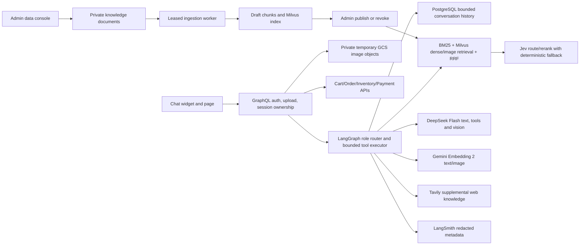

# Implementation Plan: GoshopX AI Shopping Assistant

## Runtime architecture

Commerce backends remain authoritative. A prompt or external web result cannot mutate price, stock, coupon, cart, order, or payment.

## Completed checkpoints in source

- [x] Provider settings, bounded DeepSeek requests/tool calls and grounded agent response.
- [x] Four LangGraph role paths, deterministic fallback, Jev route confidence gate and optional rerank.
- [x] Tavily supplemental search with one-call bound, three-source result cap and cache.
- [x] BM25 + dense/image retrieval fusion and hard eligibility filters.
- [x] PostgreSQL conversation history, owner-scoped thread IDs and serialized writes.
- [x] GraphQL/gRPC chat session, source, product attributes and delete-history contract.
- [x] Redacted LangSmith metadata callback and pre-call conservative VND reservation ledger.
- [x] Private GCS upload reference path, Workload Identity reader and one-day lifecycle rule.
- [x] Responsive customer chat/cards/comparison/sources UI; TypeScript compile passes.

## Remaining phases

### Phase A: Admin knowledge ingestion
- [x] Add admin-only upload/list/publish/revoke contract and UI; PDF upload is accepted after locking `pypdf` into the runtime. Scanned PDFs are rejected with an OCR-required error.
- [x] Parse PDF/DOCX/TXT/MD/JSON/CSV with limits and optional validated product linking; admin preview returns bounded chunk samples and token/rate-based estimated cost without calling providers.
- [x] Add PostgreSQL durable job lease/retry/cancel and worker; store originals privately in GCS.
- [x] Retrieve only published source revisions from PostgreSQL/Milvus.
- [x] Retry per item and idempotency tests exist; enqueue/cancel/retry/publish/revoke audit events persist with actor identity in the same transaction and display in the AI-data admin panel.

### Phase B: Commerce proposals
- [x] Serialize cart mutations per account with a Redis token lock; owner-bound, expiring, versioned proposals use idempotent confirmation and reservation compensation. Compensation uses a bounded detached context so request cancellation does not prevent rollback.
- [~] Order quote/coupon validation and atomic redemption with order are implemented; Payment reloads Order to verify owner/items/current catalog subtotal. `LAB10` seed SQL is included. Coupon administration and per-item partial-result reporting remain open.
- [x] Recheck current catalog price and coupon on a non-consuming quote preview and again when creating the order. Order persists quote ID, owner, item hash, cart version, expiry and atomically consumes the quote with order/coupon redemption; retrying a consumed quote returns the existing order.
- [~] Payment reconciles its amount to the persisted Order payable amount. Inventory reservation/cart/order compensation and webhook recovery still need integration tests.

### Phase C: Index lifecycle, memory and spend
- [x] Product seed records source system/source ID and per-run snapshot UUID; validates the full import. Inventory seed validates its full response and initializes stock insert-only.
- [x] Immutable vector generation registry, source ID/hash validation before activation, transactional activation and rollback.
- [ ] Add summary compaction and explicit expiry/deletion tests against PostgreSQL, including user isolation.
- [x] Settle DeepSeek/Gemini token usage and Tavily/TypeSafe per-call estimates when operator rates are configured; keep conservative reservations for unknown usage/timeouts. Provider invoice reconciliation and a spend dashboard remain open.
- [~] JPEG/PNG uploads are decoded, dimension-limited, orientation-normalized and stripped of metadata. WebP metadata is stripped and rotated images rejected, but compressed pixel decoding remains open.

### Phase D: acceptance and rollout
- [x] Run offline Python and targeted Go tests plus Web TypeScript compile; browser visual/E2E still needs a clean CI/browser environment because local Vite can hit Windows `spawn EPERM`.
- [ ] Run one low-volume live provider smoke only after checking the current AI budget and balance.
- [ ] Push rebuilt images, merge/promote GitOps digests, confirm Argo Healthy/Synced and GKE WI access.
- [ ] Verify real public-host flows, recovery, latency, error behavior and provider cost; record evidence and limitations.
- [ ] Update README/ADRs/runbooks from verified behavior, then mark the feature complete only after every acceptance gate passes.
