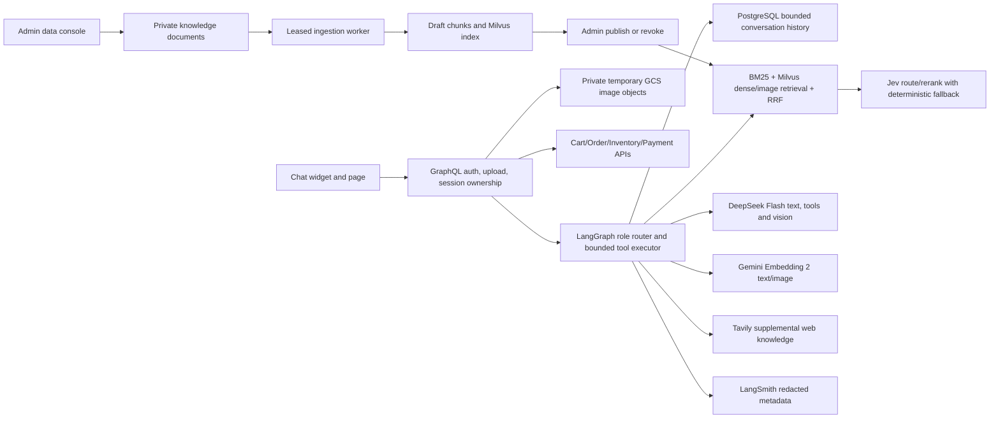

# Implementation Plan: GoshopX AI Shopping Assistant

## Runtime architecture

Commerce backends remain authoritative. A prompt or external web result cannot mutate price, stock, coupon, cart, order, or payment.

## Completed checkpoints in source

- [x] Provider settings, bounded DeepSeek requests/tool calls and grounded agent response.
- [x] Four LangGraph role paths, deterministic fallback, Jev route confidence gate and optional rerank.
- [x] Tavily supplemental search with one-call bound, three-source result cap and cache.
- [x] BM25 + dense/image retrieval fusion and hard eligibility filters.
- [x] PostgreSQL conversation history, owner-scoped thread IDs and serialized writes.
- [x] GraphQL/gRPC chat session, source, product attributes and delete-history contract.
- [x] Redacted LangSmith metadata callback and pre-call conservative VND reservation ledger.
- [x] Private GCS upload reference path, Workload Identity reader and one-day lifecycle rule.
- [x] Responsive customer chat/cards/comparison/sources UI; TypeScript compile passes.

## Remaining phases

### Phase A: Admin knowledge ingestion
- [x] Add admin-only upload/list/publish/revoke contract and UI; PDF upload is accepted after locking `pypdf` into the runtime. Scanned PDFs are rejected with an OCR-required error.
- [x] Parse PDF/DOCX/TXT/MD/JSON/CSV with limits and optional validated product linking; admin preview returns bounded chunk samples and token/rate-based estimated cost without calling providers.
- [x] Add PostgreSQL durable job lease/retry/cancel and worker; store originals privately in GCS.
- [x] Retrieve only published source revisions from PostgreSQL/Milvus.
- [x] Retry per item and idempotency tests exist; enqueue/cancel/retry/publish/revoke audit events persist with actor identity in the same transaction and display in the AI-data admin panel.

### Phase B: Commerce proposals
- [x] Serialize cart mutations per account with a Redis token lock; owner-bound, expiring, versioned proposals use idempotent confirmation and reservation compensation. Compensation uses a bounded detached context so request cancellation does not prevent rollback.
- [~] Order quote/coupon validation and atomic redemption with order are implemented; Payment reloads Order to verify owner/items/current catalog subtotal. `LAB10` seed SQL is included. Coupon administration and per-item partial-result reporting remain open.
- [x] Recheck current catalog price and coupon on a non-consuming quote preview and again when creating the order. Order persists quote ID, owner, item hash, cart version, expiry and atomically consumes the quote with order/coupon redemption; retrying a consumed quote returns the existing order.
- [~] Payment reconciles its amount to the persisted Order payable amount. Inventory reservation/cart/order compensation and webhook recovery still need integration tests.

### Phase C: Index lifecycle, memory and spend
- [x] Product seed records source system/source ID and per-run snapshot UUID; validates the full import. Inventory seed validates its full response and initializes stock insert-only.
- [x] Immutable vector generation registry, source ID/hash validation before activation, transactional activation and rollback.
- [~] Summary compaction, seven-day expiry and owner-scoped deletion are implemented in source; live PostgreSQL expiry/deletion and cross-account isolation still need hosted acceptance.
- [x] Settle DeepSeek/Gemini token usage and Tavily/TypeSafe per-call estimates when operator rates are configured; keep conservative reservations for unknown usage/timeouts. Provider invoice reconciliation and a spend dashboard remain open.
- [x] JPEG/PNG/WebP uploads are fully decoded, dimension-limited, orientation-normalized where supported, and re-encoded to strip metadata. Rotated/animated WebP is rejected; unit coverage exists.

### Phase D: acceptance and rollout
- [x] Offline Python and targeted Go tests plus Web TypeScript compile have passed in CI; Helm lint/render passes. Browser visual/E2E still needs a browser environment because local Vite can hit Windows `spawn EPERM`.
- [~] Low-volume live smoke passed for DeepSeek, Jev, Tavily and redacted LangSmith metadata. Gemini Embedding 2 returned HTTP 429 five times; catalog dense/image index smoke remains blocked on provider quota.
- [x] Rebuilt immutable image digests passed GCP quality, CodeQL, Trivy and image-build gates; promotion PR #21 merged. Argo is `Synced/Healthy` at `a2a0acab519eafbda6bfc2ec664d65e70bf7595d`, every deployment is `1/1`, and Kibana is absent from the GCP profile.
- [~] Public-host smoke verified `/`, `/login`, and two GraphQL `recommendChat` cases (one correct no-result and one catalog-backed laptop recommendation). Browser-driven image search, follow-up memory, admin ingestion, cart confirmation, coupon quote, recovery, load/latency, and full cost reconciliation remain unverified.
- [~] Documentation has current rollout and text-smoke evidence; final completeness depends on Gemini quota/index activation and live acceptance of the remaining browser, commerce and lifecycle flows.

## Latest live evidence (2026-11-07)

- The GCP release passed quality, CodeQL, Trivy and all 14 image builds; digest promotion PR #21 was merged. Argo `goshopx-gcp-lab` is `Synced/Healthy` at revision `a2a0acab519eafbda6bfc2ec664d65e70bf7595d` and every deployment is `1/1 Ready`. Kibana is absent from the GCP profile; Grafana/Loki remains the supported logging path.
- Public `/` and `/login` returned HTTP 200. Public GraphQL text smoke returned HTTP 200 for a grounded no-result laptop query below ₫20 million and a positive recommendation of catalog product 81 at ₫27,499,750 for a ₫30 million budget. The latter identified missing weight data rather than inventing a specification.
- The live SQL snapshot had zero vector generations and zero ingestion jobs after five Gemini Embedding 2 requests returned HTTP 429. Dense/image retrieval and live document ingestion are therefore not accepted. Browser follow-up/image, admin upload/publish, cart proposal confirmation, coupon quote, hosted ownership isolation and observed GCS lifecycle expiry are still open.
- DeepSeek, Jev, Tavily and redacted LangSmith metadata have bounded live smoke evidence. The spend ledger recorded estimated/reserved usage; it is not a provider invoice reconciliation. See `docs/chatbot-provider-gke-runbook.md` for gated operator steps.
